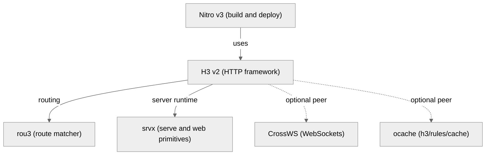

# Ecosystem

> The libraries behind H3 and the features Nitro adds.

H3 v2 handles HTTP routing, middleware, and responses using web standards. You can run it directly, add WebSockets or caching as needed, and use it with Nitro for builds and deployment.



Nitro uses H3, and H3 uses `rou3` and `srvx`. The dashed arrows mark H3's optional peers, CrossWS and `ocache`.

## Running H3 Directly

For many APIs and edge functions, you can run H3 with a single server file.

- Use `serve(app)` to start a local or production listener on Node.js, Bun, or Deno.
- Use [`app.fetch`](/guide/api/h3#h3fetch) to export a standard Web `Request` / `Response` handler directly for runtimes such as Cloudflare Workers, Deno Deploy, or Bun, or to [mount](/guide/basics/nested-apps) H3 inside another Web-standard app.
- In a browser Service Worker, register a `fetch` event listener and pass the result of `app.fetch(event.request)` to `event.respondWith()`.
- Use [`app.request()`](/guide/api/h3#h3request) to invoke routes in tests without opening a network port.

::code-group

```js [serve()]
import { H3, serve } from "h3";

const app = new H3().get("/", () => "Hello!");

serve(app, { port: 3000 });
```

```js [app.fetch]
import { H3 } from "h3";

const app = new H3().get("/", () => "Hello!");

export default { fetch: app.fetch };
```

```js [Service Worker]
import { H3 } from "h3/service-worker";

const app = new H3().get("/", () => "Hello!");

self.addEventListener("fetch", (event) => {
  event.respondWith(app.fetch(event.request));
});
```

::

## Direct Dependencies

H3 ships with two direct dependencies, keeping the core focused on Web standards:

- **[rou3](https://github.com/h3js/rou3)** powers matching for [routes](/guide/basics/routing), route-scoped [middleware](/guide/basics/middleware), and [route rules](/guide/rules).
- **[srvx](https://srvx.h3.dev)** provides the web-standard server layer behind `serve()` on Node.js, Bun, and Deno. The `h3/node` entry also uses it to adapt H3 apps for `node:http` via `toNodeHandler`.

## Optional Peer Dependencies

Install these peers when you use the corresponding feature.

- **[CrossWS](https://crossws.h3.dev)** adds cross-runtime WebSocket support through `defineWebSocketHandler()` and the `crossws/server` plugin passed to `serve()`. See [WebSockets](/guide/advanced/websocket).
- **[ocache](https://github.com/unjs/ocache)** backs the `cache` and `swr` rules available from `h3/rules/cache`. See [Route Rules Caching](/guide/rules#caching).

## Building and Deploying with Nitro

[Nitro v3](https://nitro.build) uses H3 v2 and adds tooling for building and deploying a server.

You can export an H3 app from a [`server.ts` entry](https://nitro.build/docs/server-entry) or enable [filesystem routing](https://nitro.build/docs/routing) by configuring a server directory. Nitro can bundle the app for a [deployment preset](https://nitro.build/deploy) and [prerender routes](https://nitro.build/docs/prerendering) during the build.
